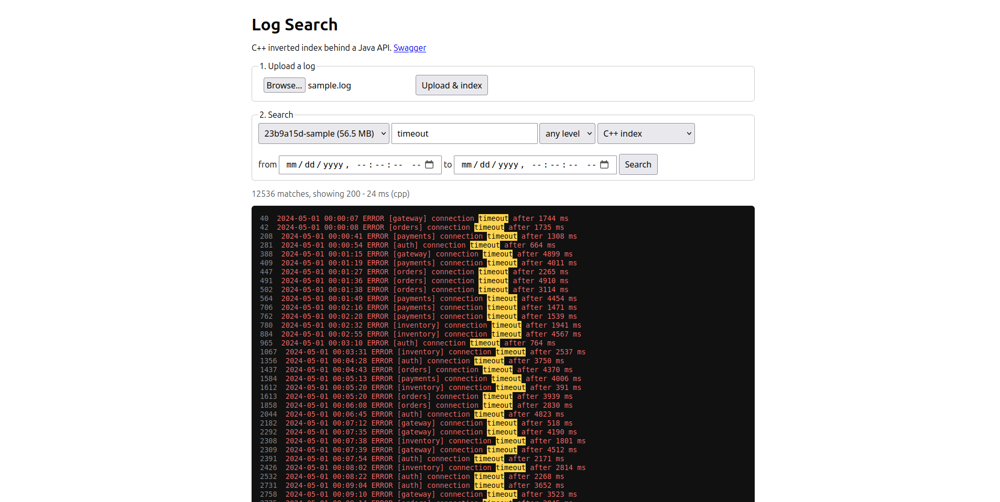
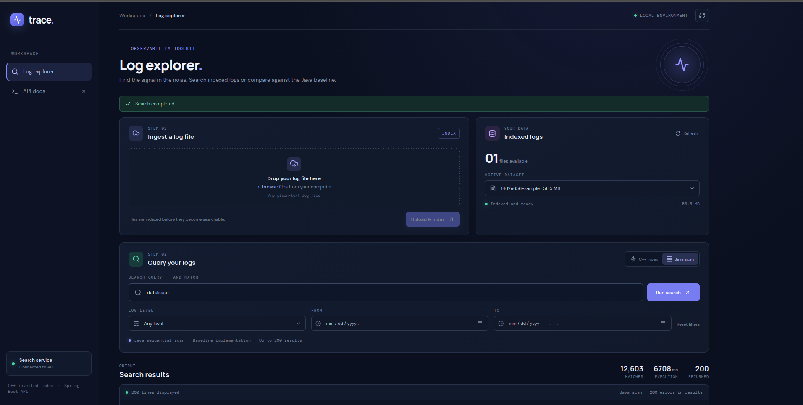
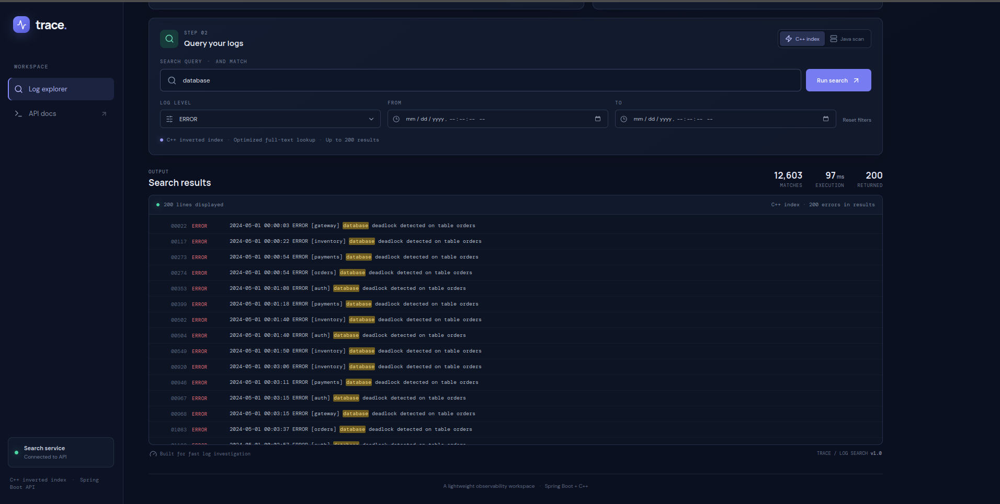

# ⚡ Log Search Engine

A high-performance log search engine built with **C++17 and Java Spring Boot**.

Upload large log files, construct an inverted index, and search through millions of log entries efficiently. The project combines the performance of a C++ search engine with the flexibility of a Java REST API.



## Updated Frontend (React)



## 📊 Performance Benchmarks

To evaluate the performance of the inverted index, the C++ search engine was compared against the Java baseline implementation, which performs a linear scan of the log file.

### Search Performance

| Log Entries | C++ (Inverted Index) | Java (Linear Scan) | Speedup |
|---:|---:|---:|---:|
| 10,000 | 27 ms | 4,895 ms | **181.3×** |
| 1,000,000 | 49 ms | 6,584 ms | **134.4×** |

### Key Observations

- **10K entries:** Indexed search was approximately 181 times faster than the Java baseline.
- **1M entries:** Indexed search was approximately 134 times faster.
- **Search Efficiency:** Increasing the dataset size by 100× increased the observed C++ search time from 27 ms to just 49 ms.

These results highlight the performance advantage of inverted indexing over traditional linear scanning for log searches.

### Benchmark Methodology

- Both implementations were tested against the same log datasets.
- Identical search queries and filtering conditions were used.
- Search execution times were obtained using the API's `tookMs` response field.

### Benchmark Environment

- **C++:** C++17
- **Java:** Java 17
- **Backend:** Spring Boot

*Note: Results are dependent on hardware, query characteristics, system load, caching and implementation details. Measurements should be interpreted in the context of the benchmark environment.*

## 🚀 Key Features

- **Fast Full-Text Search:** C++ inverted index for efficient log searching.
- **Multi-Word Search:** AND-based matching across multiple search terms.
- **Log Level Filtering:** Filter results by ERROR, WARN, INFO, DEBUG, or TRACE.
- **Time Range Filtering:** Search logs within specific date and time ranges.
- **Dual Search Engines:** Compare indexed C++ search against a Java-based linear scan.
- **REST API:** Upload, list, search, and delete log files through HTTP endpoints.
- **Web Interface:** Browser-based interface for uploading logs and exploring search results.
- **No Database Required:** Log files and index files are stored locally.

---

## 🏗️ Architecture

The application follows a lightweight, two-component architecture consisting of a C++ indexing engine and a Java Spring Boot API.

```text
                  Browser / cURL
                       |
                       v
              Java Spring Boot API
                       |
          +------------+------------+
          |            |            |
        Upload       Search      Filters
          |            |
          v            v
      api/data/    C++ Indexer
                       |
                       v
                 Inverted Index
                       |
                       v
                  .idx / .off
                       |
                       v
                Matching Results
                       |
                       v
              Java REST API
                       |
                       v
                  JSON Response
```

### Technology Stack

| Component | Technology | Responsibility |
|---|---|---|
| Search Engine | C++17 | Index construction and indexed search |
| Backend API | Java 17, Spring Boot | REST endpoints, uploads, validation, filtering |
| Frontend | HTML, CSS, JavaScript | Log upload and search interface |
| Build System | CMake, Maven | Building and running the application |
| Storage | Local Filesystem | Log files and index files |

---

## 🔍 How It Works

The application uses an inverted index to avoid scanning the entire log file for every search request.

### 1. Index Construction (C++)

When a log file is uploaded:

1. The C++ indexer reads the file line by line.
2. Records the byte offset of each line in a binary `.off` file.
3. Tokenizes and normalizes words to lowercase.
4. Builds an inverted index mapping each word to its corresponding line numbers.
5. Stores the inverted index in a text-based `.idx` file.

**Example inverted index:**

```text
timeout    12,32,45,89
payment    12,45,67
error      32,45,89
```

The `.off` file stores byte offsets that allow the engine to retrieve original log entries without scanning the file from the beginning.

### 2. Search Execution (C++)

When a search request arrives:

1. Extracts and normalizes the search terms.
2. Locates the corresponding posting lists in the inverted index.
3. Intersects the posting lists to identify lines containing all search terms.
4. Uses the `.off` file to retrieve the original matching log entries.
5. Returns matching line numbers and log messages to Java.

This avoids repeatedly scanning the entire log file for every search request.

### 3. API Processing (Java)

The Spring Boot application handles:

- File uploads and deletion.
- Search request validation.
- C++ indexer execution as a child process.
- Log-level filtering.
- Date and time filtering.
- Result pagination.
- JSON response generation.

### 4. Search Engine Comparison

The application supports two search engines:

| Engine | Implementation |
|---|---|
| `cpp` | Inverted-index-based search |
| `java` | Baseline linear scan |

Both engines allow search execution times to be compared using the API's `tookMs` response field.

---

## 📋 Prerequisites

Make sure the following tools are installed:

| Tool | Requirement |
|---|---|
| C++ Compiler | g++ 9+ with C++17 support |
| CMake | 3.14+ |
| Java | JDK 17+ |
| Maven | 3.8+ |
| Python | Python 3 (for sample log generation) |

---

## ⚙️ Installation & Setup

### Step 1: Clone the Repository

```bash
git clone <repository-url>
cd <repository-name>
```

### Step 2: Build the C++ Indexer

Navigate to the indexer directory and build the project:

```bash
cd indexer

cmake -S . -B build
cmake --build build

cd ..
```

This generates the C++ executable:

```text
indexer/build/logindex
```

### Step 3: Start the Spring Boot API

Navigate to the `api/` directory:

```bash
cd api

mvn spring-boot:run
```

The API will be available at:

```text
http://localhost:8080
```

**Swagger UI:**

```text
http://localhost:8080/swagger-ui.html
```

### Step 4: Generate a Sample Log File

Open another terminal from the project root:

```bash
python3 scripts/generate_logs.py 1000000 sample.log
```

This generates a sample log file containing 1,000,000 entries.

### Step 5: Upload and Search

Open the web interface:

```text
http://localhost:8080
```

Upload `sample.log` and start searching.

**Try searching for:**

```text
timeout
```

You can also combine multiple search terms with filters such as `ERROR` and a specific time range.

---

## 🌐 REST API Reference

### Available Endpoints

| Method | Endpoint | Description |
|---|---|---|
| POST | `/api/logs` | Upload a log file and build its index |
| GET | `/api/logs` | Retrieve all uploaded log files |
| DELETE | `/api/logs/{id}` | Delete a log file and its index |
| GET | `/api/logs/{id}/search` | Search within an uploaded log file |

### Search Parameters

| Parameter | Description | Default |
|---|---|---|
| `q` | Search terms (all terms must match) | — |
| `level` | Log level: ERROR, WARN, INFO, DEBUG, TRACE | Optional |
| `from` | Start timestamp | Optional |
| `to` | End timestamp | Optional |
| `limit` | Maximum number of results (max 1000) | 100 |
| `engine` | Search engine: `cpp` or `java` | `cpp` |

### API Examples

**1. Upload a log file**

```bash
curl -F file=@sample.log http://localhost:8080/api/logs
```

**2. Search using the C++ inverted index**

```bash
curl "http://localhost:8080/api/logs/<id>/search?q=timeout&level=ERROR&limit=5"
```

**3. Search using the Java baseline**

```bash
curl "http://localhost:8080/api/logs/<id>/search?q=timeout&engine=java"
```

**4. Search within a time range**

```bash
curl "http://localhost:8080/api/logs/<id>/search?q=timeout&from=2024-05-01T00:00:00&to=2024-05-02T00:00:00"
```

---

## 📄 Supported Log Format

The application expects timestamps and log levels in the following format:

```text
2024-05-01 12:00:01 ERROR [orders] connection timeout
2024-05-01 12:00:05 INFO [payments] transaction completed
2024-05-01 12:00:10 WARN [gateway] response delayed
2024-05-01 12:00:15 DEBUG [auth] validating session
```

### Search Behavior

- Word search works across the entire log message.
- Search terms are case-insensitive.
- Multiple search terms use AND matching.
- Level filtering requires the log level to appear as a separate word.
- Time filtering requires the timestamp prefix in `yyyy-MM-dd HH:mm:ss` format.

---

## 📁 Project Structure

```text
log-search/
│
├── indexer/
│   ├── src/
│   │   └── ...
│   ├── CMakeLists.txt
│   └── build/
│       └── logindex
│
├── api/
│   ├── src/
│   │   └── main/
│   │       ├── java/
│   │       └── resources/
│   ├── data/
│   │   ├── <id>.log
│   │   ├── <id>.idx
│   │   └── <id>.off
│   └── pom.xml
│
├── scripts/
│   └── generate_logs.py
│
├── output/
│   └── log-search-output.png
│
└── README.md
```

---

## 💾 Storage Design

No external database is required.

Each uploaded log file generates three local files:

| File | Purpose |
|---|---|
| `<id>.log` | Original uploaded log file |
| `<id>.idx` | Inverted index containing words and posting lists |
| `<id>.off` | Binary file containing byte offsets for log lines |

The offset file allows the C++ engine to retrieve matching log entries directly from the original file instead of scanning it from the beginning.

---

## 🔮 Future Improvements

Some planned enhancements:

- **Phrase Search:** Support exact phrase matching using word positions.
- **Top Errors:** Add an endpoint to summarize the most frequent errors.
- **Persistent C++ Engine:** Keep the index loaded in memory using a long-running C++ process or gRPC.
- **Compact Index Format:** Replace the text-based index with a more space-efficient binary representation.
- **Parallel Search:** Explore parallel posting-list intersection for large indexes.
- **Automated Testing:** Add JUnit tests for the Java search service and C++ unit tests for tokenization and indexing.
- **Benchmarking:** Compare search performance across different log sizes and query patterns.

---

## 🎯 Project Goal

This project explores how an inverted index can significantly improve log-search performance compared with a traditional linear scan.

It also demonstrates how C++ and Java can work together, combining low-level performance-oriented processing with a high-level REST API.

**Built with C++17, Java 17, and Spring Boot.**